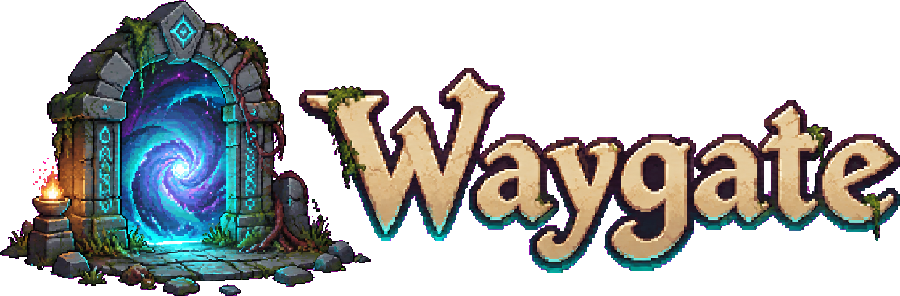
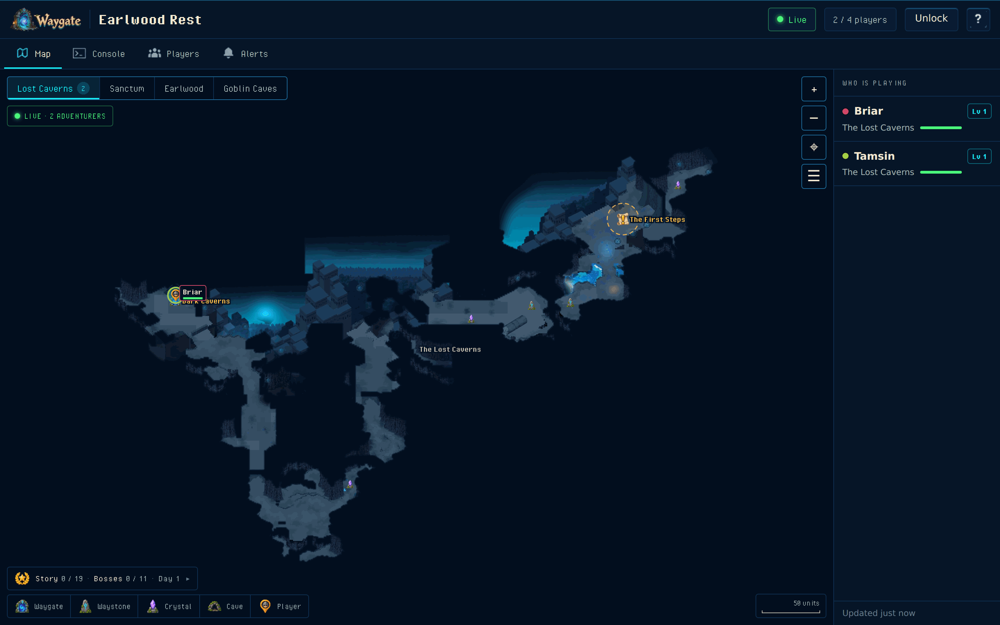
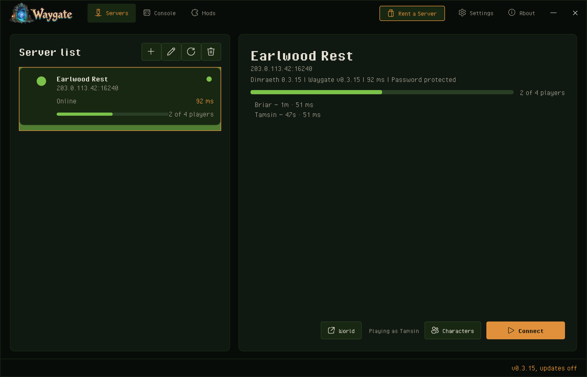
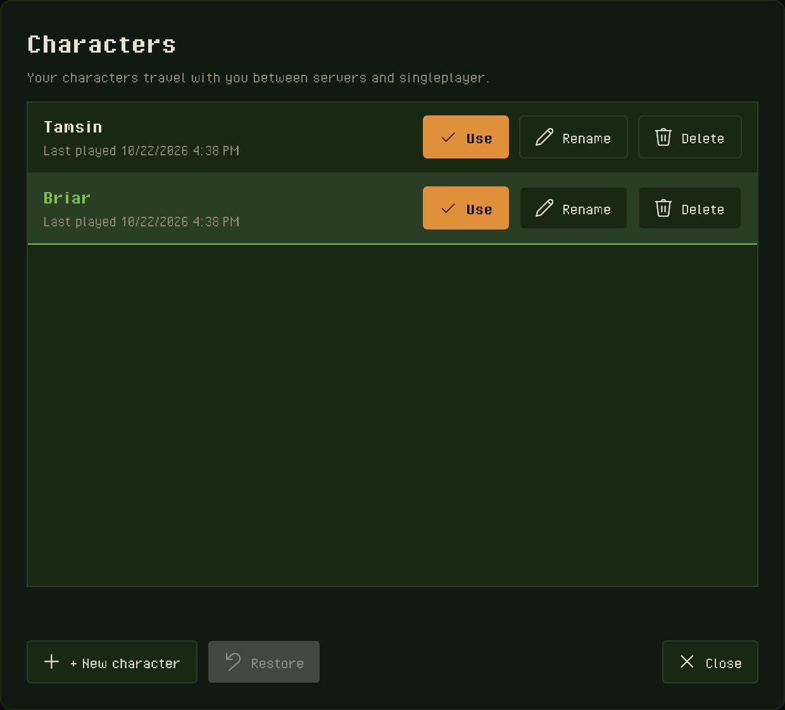
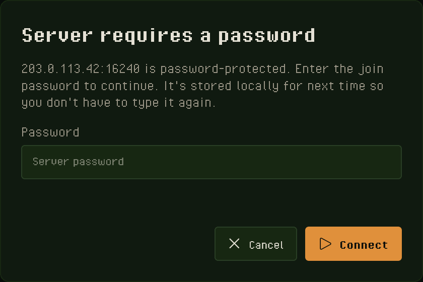
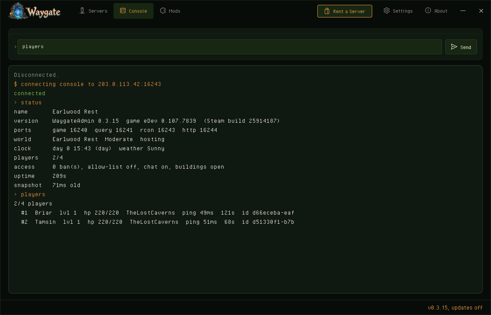
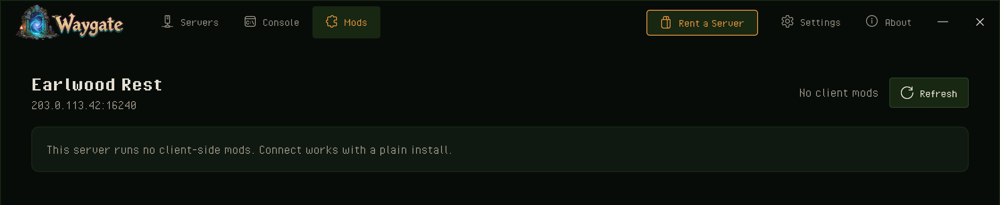

  

  
  
  
  
  

# Waygate

Dimraeth has no dedicated server. Its multiplayer is a Steam lobby hosted from one player's copy of the game. Waygate adds a Dimraeth dedicated server. Players join it by IP with the Waygate app.

Every player needs the Waygate app to join.

## Features

### 🗺️ Live map
Every Waygate server has its own web page with a live map: the world drawn from the game's own pixels, every player's position every five seconds, the Waygates and crystals they've found, and fog of war over ground nobody has explored yet. The owner unlocks the console, kick and ban, and Discord alerts with the admin password. Details in [WaygateServer](https://github.com/HumanGenome/WaygateServer#the-web-page).

  

### 🧭 Join by IP
Click Add server in the app, type the server's IP and port, pick a character and click Connect. The app starts Dimraeth and joins the server. Your server list shows whether each server is up, who's on it, your ping, and the game version it runs beside your own.

  

### 🧝 Bring your single-player character
Characters are made in the game as always and stay on your PC. The app lists them and you choose which one to bring to a server. Deleting a character in the app deletes it for good.

  

### 🔒 Password protection
Set one on the server and the app asks for it before connecting.

  

### 🖥️ Server console
The app's Console tab shows the server's live log and runs admin commands once the server has an admin password. Any Source RCON tool works too.

  

### 🧩 Mods
Server mods run on the server, so players install nothing. When a server needs a mod on your PC too, the Mods tab asks once, installs it for that server only when you connect, and removes it when the server stops using it. Starting Dimraeth from Steam runs the normal game.

  

## Install

### Rent a server
[SurvivalServers.com](https://www.survivalservers.com/services/game_servers/dimraeth/?utm_source=github&utm_medium=readme_install&utm_campaign=waygate) runs Dimraeth servers with WaygateServer installed. Command Center has an Open in Waygate button that adds the server to the app.

### Players
1. Download `WaygateSetup-latest.exe` from the [latest release](https://github.com/HumanGenome/Waygate/releases/latest/download/WaygateSetup-latest.exe).
2. Run it. If Windows shows "Windows protected your PC", choose More info, then Run anyway. One install per PC.
3. Open Waygate, click Add server and type the server's IP and port.
4. Pick a character and click Connect.

If Windows says Smart App Control blocked the installer, wait a day or two for Windows to recognize the new version and run it again, or turn Smart App Control off in Windows Security under App & browser control.

The app updates itself when a new version is out.

### Host your own
You need a Windows PC and Dimraeth's game files from your own Steam copy. Setup, ports and settings are in [WaygateServer](https://github.com/HumanGenome/WaygateServer).

## Releases

This repo has the app's installer, `WaygateSetup-<version>.exe` (also as `WaygateSetup-latest.exe`), and its release notes. The server download is on the [WaygateServer release page](https://github.com/HumanGenome/WaygateServer/releases/latest), and the changelog for both is in [WaygateServer's CHANGELOG](https://github.com/HumanGenome/WaygateServer/blob/main/CHANGELOG.md).

## Source

- **Waygate** (this repo): the app players install, the downloads and the documentation.
- **[WaygateServer](https://github.com/HumanGenome/WaygateServer)**: the server download you unzip into Dimraeth's game folder.

## FAQ

### How many players can join?
Up to 8, the number Mudtek gives on Dimraeth's [Steam page](https://store.steampowered.com/app/2402680/). The server has no character of its own, so it doesn't count toward that limit. The first player in leads the party and the rest join it. The server's owner sets the player limit.

### Does it change my game?
It adds `winhttp.dll`, `doorstop_config.ini`, `.doorstop_version` and the `BepInEx` and `dotnet` folders next to `Dimraeth.exe`. Steam updates the game as normal. Uninstalling the app leaves the game folder alone. Delete those five to remove Waygate from the game.

### Does single-player still work?
Yes. Starting Dimraeth from Steam runs the normal game. The mod only acts when the app starts the game, and then the game's version corner shows the Waygate version too. It does one thing on every start: if Steam Cloud brings back a character you deleted in the app, it deletes that character again.

### Where is my character saved?
On your PC, where Dimraeth keeps it. The server holds the world.

### Can a world move between servers?
Yes. In the app's World window (it needs each server's admin password), Migrate from another server brings in the newest snapshot of another server saved in the app; or Download a snapshot from one server and use Import a save on the other. The world comes in under that server's World Name at its next start, and the world it replaces is kept. By hand: a world is one file, `waygate\save\Worlds\<world name>.jrwf`. Copy it to the other server's Worlds folder and set that server's World Name to match.

## Contributing

Bugs: [open an issue](https://github.com/HumanGenome/Waygate/issues).

See [CONTRIBUTING.md](CONTRIBUTING.md). Security issues go through [private reporting](.github/SECURITY.md), never a public issue.

## Community note

Waygate is an independent community project. It is not affiliated with, endorsed by, or supported by Mudtek.

## License

MIT, see [LICENSE](LICENSE).
